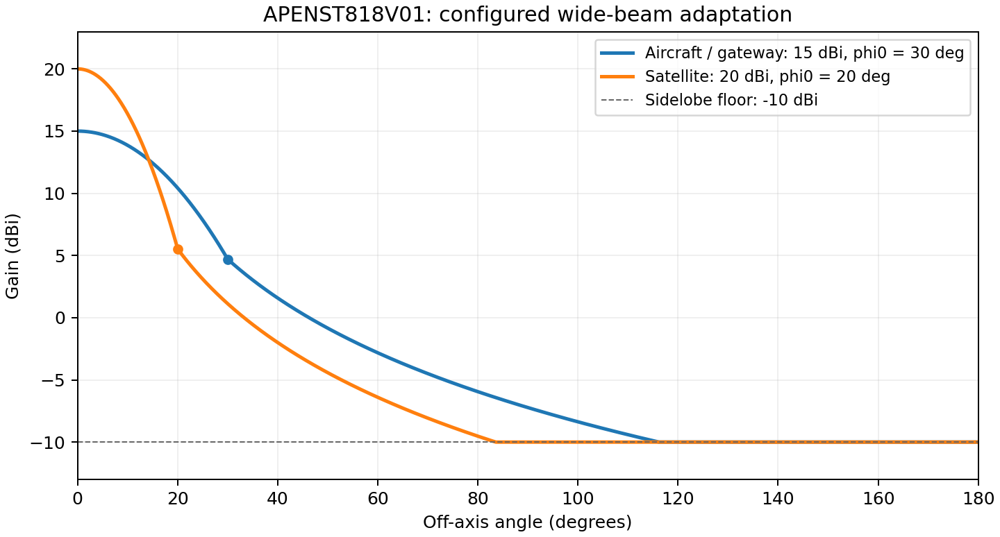

# 下行同频干扰与统一方向图

实现范围为卫星下行飞机（DOWNLINK）和卫星下行地面网关（FEEDER_DOWNLINK）。上行保留原有噪声预算。本次使用用户提供的 `config/APENST818V01.pdf`，已提取文本并渲染核对公式。

## 网页及配置

「场景参数 → 下行干扰与频率补偿」提供下行聚合干扰开关。开启时自动选择 IDEAL 多普勒补偿。示例项目已经启用；旧项目缺省关闭，可继续使用 SIMPLE。修改后先保存，再开始运行。

```yaml
propagation:
  downlink_interference_model: COCHANNEL_AGGREGATE # NONE 关闭
  doppler_compensation: IDEAL # FIXED 用于关闭干扰时的固定调谐实验
```

「天线配置」中每行可独立编辑峰值增益、分段角、孔径效率、A 和 B；飞机、网关、卫星和收发两端共用公式，但不绑定为同一组参数。各下行链路还可以设置 `min_sinr_db`；未填写时沿用 `min_cn_db` 作为干扰后门限。

## APENST818V01 及原参数适配

角度以度为单位，增益以 dBi 为单位，log 为十进对数：

```
D/lambda = sqrt(10^(Gmax/10) / (eta*pi^2))
G(phi) = Gmax - 0.0025*(D/lambda*phi)^2         (0 <= phi < phi0)
G(phi) = max(A - B*log10(phi), -10)             (phi0 <= phi <= 180)
```

保留原配置峰值和角度数字，`beamwidth_deg` 在这个模型中明确解释为分段角 phi0，而不是半功率全波束宽度。效率 `aperture_efficiency` 缺省 0.7，`pattern_coefficient_b` 缺省 25。`pattern_coefficient_a` 留空时，通过 `A = Gmain(phi0) + B*log10(phi0)` 使两段连续。

| 平台 | Gmax | phi0 | eta | B | 自动适配 A |
| --- | --- | --- | --- | --- | --- |
| 飞机、网关收发端 | 15 dBi | 30° | 0.7 | 25 | 41.629276 |
| 卫星收发端 | 20 dBi | 20° | 0.7 | 25 | 38.051295 |



PDF 的建议 phi0 为 0.1° 至 10°。现有 20°/30° 超出建议范围，因此配置校验会明确给出 PATTERN_WIDE_BEAM 警告。这是按用户原参数进行的宽波束适配，不是合规认证或实测方向图；原始资料为地球站方向图，在卫星端共用公式也是本场景的建模假设。A 必须在 [18,52]、B 在 [10,50]，且主瓣边界不能低于旁瓣包络。按照 PDF，交叉极化方向图等于同极化方向图；未另加交叉极化隔离增益。

## 干扰源与指向

1. 仅使用本次运行纳入的已启用卫星和配置的卫星下行 TX。卫星数量限制也会限制干扰源集合，测试少量卫星不等于完整星座干扰。
2. 每颗卫星上各下行 TX 对应一个持续发射的波束，指向该链路原有的飞机或网关终端。相同 TX ID 不能同时分配两个链路；两个独立波束需使用不同 TX ID。
3. 对每条候选服务卫星链路重新确定接收天线指向：接收端始终指向当前候选服务卫星。干扰卫星的发射波束不随候选服务卫星改变。
4. 排除服务卫星的所有发射波束；本版只分析非服务卫星干扰，不包含服务卫星内部波束间干扰。
5. 以受扰接收端为基准，要求干扰卫星具有 STK 几何 Access，并达到场景的最低仰角。不可见或低于门限的卫星贡献为零，不能靠方向图背瓣或旁瓣绕过遮挡。
6. 同频定义为标称中心频率相差不超过 1 Hz；不同中心频率不纳入本模型，不包含邻道泄漏。不同带宽的同频信号由 STK 接收带宽重叠计算有效入带功率。由于使用 STK 默认 BPSK，要求下行 TX 配置带宽等于两倍数据率。

这是一组明确的同频满负荷假设，没有随机调度或业务活动概率。不同卫星上的 STX1 与 SFTX1 是不同的物理波束，均可能向飞机或网关造成干扰；不会将同一个 TX 因候选链路复制而重复计数。

## 计算及输出口径

STK Simple TX/RX 提供理想对准的路径预算，包括已经启用的雨衰、气体吸收、云雾和闪烁。跨路径按“干扰 TX → 实际受扰 RX”单独计算并缓存，不能借用干扰 TX 到自己服务终端的路径损耗。

平台从 STK 读取同一时刻的地固系位置，分别计算发射离轴角（本波束指向的终端与受扰终端夹角）及接收离轴角（候选服务卫星与干扰卫星夹角）。根据 PDF 的解析公式计算增益，并相对于 STK 基础预算中已包含的峰值增益施加差值，避免重复加峰值增益。

干扰贡献功率转换为 W 后相加。若 `C/N` 是原始噪声预算，`C/I` 是期望信号与聚合干扰之比，则在线性域计算 `SINR = 1 / (1/(C/N) + 1/(C/I))`。`Eb/(N0+I0)` 相对于原始 Eb/No 减去相同的干扰劣化。

有干扰时，干扰后 BER 使用相干未编码 BPSK 的 AWGN 公式，将聚合干扰近似为高斯噪声；它不是波形级干扰仿真，也不是 STK 原始调制查表 BER。无干扰时保留原始 STK BER。

这是 **STK 路径预算加平台侧解析聚合**，不是原生 STK CommSystem 干扰报告。保存的 STK 场景保留 Simple 等效设备；统一方向图实际用于平台侧收发离轴计算，并导出可导入 STK 的对称 `.ant` 文件，不宣称已将方向图安装为场景中的原生 Antenna 对象。

| 文件/字段 | 内容 |
| --- | --- |
| `antenna_<ID>.ant` | 对应天线的 STK SymmetricPattern 方向图采样文件 |
| `antenna_patterns.json` | 实际使用的 Gmax、phi0、A、B、效率及适配说明 |
| `APENST818V01.pdf` | 项目 config 中存在时复制，随结果压缩包交付 |
| `interference_contributions.csv` | 每条候选链路、每时刻、每个干扰 TX 的卫星 ID、收发离轴角、增益和接收功率 |
| `link_budget.csv` 原有 `cn_db / ebno_db / ber` | STK 原始噪声预算，保持语义不变 |
| `received_iso_power_dbw` | STK 的 Rcvd. Iso. Power 原始输出 |
| `carrier_power_dbw` | 按受扰接收端峰值增益和馈线损耗换算的期望信号输入功率 |
| `interference_power_w / interference_power_dbw` | 聚合干扰功率 |
| `interferer_count / ci_db / in_db` | 干扰 TX 数量、C/I、I/N |
| `sinr_db / ebni_db / ber_with_interference` | 干扰后信号质量和 BPSK 误码近似 |
| `meets_min_sinr` | 是否达到链路干扰后门限 |

无干扰时功率 W 为 0；dBW、C/I、I/N 的无穷值以空字段表达，SINR 等于原始 C/N。主链路不可见时干扰后指标为空。上行或关闭干扰时，新增干扰字段为空。

OMNeT++ 时间线以几何可见性、原 C/N 门限和干扰后 SINR 门限共同决定 available。新增 SINR、Eb/(N0+I0)、干扰后 BER 列；原有 C/N、Eb/No、BER 保持原含义。当前 OMNeT++ 仍不基于 BER 随机丢包，配置数据率也不会随 SINR 自适应变化。

## 多普勒

IDEAL 模式在每个原生接收机开启 FrequencyAutoTracking 并回读确认；`residual_frequency_offset_hz` 按理想补偿假设置零。STK 12.6 实测 `Freq. Doppler Shift` 仍可报告非零原始频移，因此单独保留在 `stk_frequency_doppler_shift_hz` 中，不能将其误标为补偿后的残余频偏。模型未包含捕获范围、跟踪失锁或估计误差。

## 验证

`python -m unittest discover -s tests -q` 的 33 项测试通过，覆盖方向图公式、连续性、增益下限、两端离轴角、平移不变性、不可见源排除、服务卫星排除、同频筛选、线性功率求和、SINR、零干扰回退、OMNeT++ SINR 门限及网页保存校验。前端检查运行 `node tests/test_rf_controls.cjs`，包含干扰开关自动选择 IDEAL 和配置保存。更新后的实际本地服务项目读取、草稿校验和新版静态资源均通过检查。

在本机 STK 12.6 上运行 `python scripts/probe_downlink_interference.py`，使用临时项目和 SAT41917、SAT41918、SAT41923，120 秒采样，共生成 72 行预算、16 条干扰贡献，8 个采样点存在干扰。验证了几何可见性、自身排除、聚合功率、SINR 不高于 C/N、理想跟频及场景打包；临时项目自动清理，不改原项目数据。
